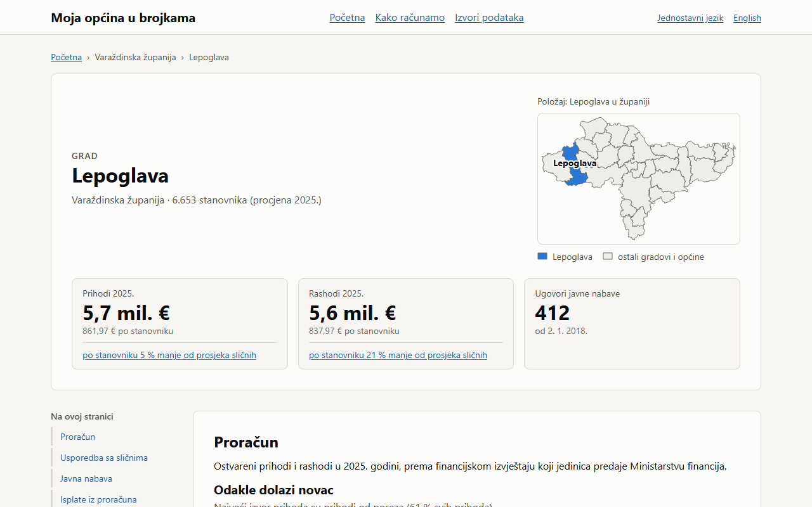

# Moja općina u brojkama

One plain-language page for each of Croatia's 556 cities and municipalities: how the local government spends money, what it buys, and which public services are nearby — compared with similar municipalities in the same county.

**Live site:** https://1212mauro.github.io/moja-opcina-u-brojkama/ (today: the 28 cities and municipalities of Varaždin County; also [in plain language](https://1212mauro.github.io/moja-opcina-u-brojkama/jednostavno/) and [in English](https://1212mauro.github.io/moja-opcina-u-brojkama/en/))

[](https://1212mauro.github.io/moja-opcina-u-brojkama/opcina/lepoglava/)

## Datathon Portala otvorenih podataka 2026

- **Solution documentation (Croatian):** [docs/prijava.md](docs/prijava.md). It covers the problem, users, features, technical architecture, every dataset with its publisher and link, prerequisites, further development, and the tools used.
- **Video presentation (1:50):** [predstavljanje.mp4 in the v0.4.0 release](https://github.com/1212mauro/moja-opcina-u-brojkama/releases/tag/v0.4.0), narration in [docs/video/naracija.md](docs/video/naracija.md), subtitles in [docs/video/predstavljanje.srt](docs/video/predstavljanje.srt).
- **Screenshots:** [docs/screenshots/](docs/screenshots/): every page type at 360, 768 and 1280 px, in light and dark mode.

## Documentation

| Document | What it covers |
| --- | --- |
| [SPEC.md](SPEC.md) | What we build and why |
| [TASKS.md](TASKS.md) | Task breakdown and progress |
| [docs/sources.md](docs/sources.md) | Every data source: URL, publisher, licence, quirks |
| [docs/pipeline.md](docs/pipeline.md) | How raw data becomes the site's JSON; quality gate; personal data |
| [docs/design.md](docs/design.md) | Frontend design and visual QA |
| [docs/pilots.md](docs/pilots.md) | Why these pilot municipalities |
| [docs/spot-check.md](docs/spot-check.md) | 50 figures checked against the source files |
| [CHANGELOG.md](CHANGELOG.md) | Release history |

## Repository layout

| Path | What it is |
| --- | --- |
| `pipeline/` | Python 3.12 pipeline: fetches open data, parses and joins it, writes JSON for the site |
| `web/` | Next.js website, exported as static files |
| `contract/` | The JSON data contract between pipeline and website (`schema.json`, examples) |
| `data/raw/` | Downloaded source files (git-ignored) |
| `docs/` | Source documentation and methodology |
| `scripts/` | Small helpers, e.g. `progress.py` |

## Running locally

Pipeline:

```bash
cd pipeline
python -m venv .venv
.venv/Scripts/activate        # Windows; on macOS/Linux: source .venv/bin/activate
pip install -e ".[dev]"
pytest
opcina fetch && opcina build  # download every source, then parse, check and export
```

Website:

```bash
cd web
npm install
npm run dev
```

`npm run build` writes the static site to `web/out/`. `npm run a11y` (axe-core) and `npm run layout` check every built page; CI runs both.

## Changing the data contract

The pipeline's Pydantic models in `pipeline/src/opcina_pipeline/contract.py` are the single source of truth for the JSON the site reads. After changing them:

```bash
cd pipeline && opcina schema           # writes contract/schema.json
cd ../web && npm run gen:types         # writes src/lib/contract.ts
```

CI fails if either generated file is out of date.

## How we work

- One branch per task section or task, named after its ID: `feat/C2-budget-parser`, `fix/D5-chart-labels`.
- Every commit message starts with the task ID: `C2: parse MinFin budget XLSX`.
- Tick the task in [TASKS.md](TASKS.md) in the pull request that finishes it.
- Pull requests go into `main`; CI must be green before merging, with a merge commit.

## Versioning

[Semantic Versioning](https://semver.org/). Before 1.0, minor versions mark milestones:

| Version | Milestone |
| --- | --- |
| 0.1.0 | MVP-1 Data in hand |
| 0.2.0 | MVP-2 First complete page |
| 0.3.0 | MVP-3 All pilots, all features |
| 0.4.0 | MVP-4 Datathon submission |
| 1.0.0 | Production v1 public launch |

Patch versions are for fixes between milestones. At a milestone: update [CHANGELOG.md](CHANGELOG.md), bump the version in `pipeline/pyproject.toml`, `pipeline/src/opcina_pipeline/__init__.py` and `web/package.json`, then tag the merge commit on `main` (`git tag -a v0.4.0 -m "MVP-4 Datathon submission"`).

## Licence

Code: [EUPL-1.2](LICENSE). Data comes from Croatian and EU public bodies under their own licences (Otvorena dozvola Republike Hrvatske, CC BY, ODbL and others, listed in [docs/sources.md](docs/sources.md)); each page credits its sources.
