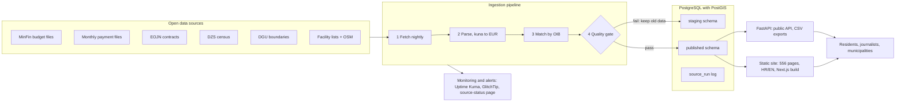

# Moja općina u brojkama — Technical Implementation Plan

22 October 2026

## Executive summary

Moja općina u brojkama gives every resident of Croatia's 556 cities and municipalities one plain-language page showing how their local government spends money, what it buys, what it announces, and which public services are nearby.

It joins five open sources that today live on separate portals: local budget execution data, monthly budget payment disclosures, public procurement notices, census figures, and locations of schools, kindergartens and health facilities. Its main new value is the comparison: each municipality is shown next to peers of similar size in the same county.

| Phase | Duration | Effort | Cash cost |
| --- | --- | --- | --- |
| Datathon MVP (5 pilot municipalities) | 4 weeks | ~320 team hours | under €50 |
| Production v1 (all 556 units) | ~6 months | ~1,100 person-hours | ~€42,000 (range €20,000–64,000) |
| Running and maintenance | per year | ~160 hours | ~€6,300 |

Cost ranges depend mostly on who builds it: a student or academic team, Croatian freelancers, or an agency. The breakdown is in the cost sections below.

## Problem and scope

The data needed to answer "how is my municipality doing?" is public but scattered: budgets sit in Ministry of Finance spreadsheets, payments on each municipality's own website, contracts in the procurement system, and service locations in separate registers. Few residents will open five portals and join the tables themselves.

| Feature | Datathon MVP | Production v1 | Phase 2 |
| --- | --- | --- | --- |
| Search by municipality name, postcode or map click | Yes | Yes | Yes |
| Budget card: revenue, spending by function, per-resident figures | 5 pilot units | All 556 units | Yes |
| Peer comparison (same county, same population band) | Basic | Full, with ranks | Trends over 5+ years |
| Recent procurement awards and top suppliers | 5 pilot units | All units | Supplier profiles linked to the court register |
| Monthly payments explorer | 1–2 units | Units that publish machine-readable files | Automated scraping of the rest |
| Map of schools, kindergartens, health facilities | Yes | Yes | Travel-time coverage gaps |
| Simple-language mode, Croatian/English, screen-reader support | Yes | Yes, audited to WCAG 2.1 AA | More languages |
| Open API and CSV downloads of the joined data | No | Yes | Yes |
| Email alerts for new contracts in my municipality | No | No | Yes |

Out of scope for all phases: personal data about officials or private individuals, and any judgment of whether spending is "good". The app shows figures and comparisons and leaves interpretation to the reader.

## Data sources

Six sources cover v1; the two hardest are monthly payments (556 separate websites) and service locations (no single national register), so both get a fallback.

| Source | Publisher | Format and access | Refresh | Used for | Known quirks |
| --- | --- | --- | --- | --- | --- |
| Budget execution of all local units ([IJF note on the dataset](https://www.ijf.hr/upload/files/file/newsletter/120.pdf)) | Ministry of Finance | XLSX download per year | Yearly, plus half-year | Budget card, per-resident figures, peer ranks | Sheet layouts shift between years; figures before 2023 are in kuna and must be converted at the fixed rate of 7.53450 HRK/EUR |
| Monthly payment disclosures ([Naputak, NN 59/23](https://narodne-novine.nn.hr/clanci/sluzbeni/2023_06_59_1003.html)) | Each city and municipality | CSV, XLSX or HTML on each unit's own website | Monthly, by the 20th | Payments explorer, top recipients | No common file format or URL pattern; payments to private individuals are aggregated by type, not named; a few units also mirror them on data.gov.hr ([example](https://data.gov.hr/ckan/en/dataset/izvjestaj-o-trosenju-sredstava/resource/c433330b-0bc5-4beb-8cdd-ba88458ece9d)) |
| Public procurement contract register ([2018–2023 file on data.gov.hr](https://data.gov.hr/ckan/en/dataset/247c96e7-fcce-42e5-8119-334f702f8c61/resource/8527585c-07d0-4c8b-8a45-029923732284)) | EOJN RH (Narodne novine d.d.) | XLSX for 2018–2023; machine-readable register in the new EOJN from 2024 | Continuous | Procurement awards, top suppliers | Two systems with different schemas; buyers must be matched to municipalities by OIB, not name |
| Census 2021 and annual population estimates | State Bureau of Statistics (DZS) | XLSX | Census every 10 years, estimates yearly | Per-resident figures, population bands for peer groups | Settlement-level tables need rolling up to municipality |
| Administrative boundaries | State Geodetic Administration (DGU), via the national geoportal | WFS / GeoJSON | Rarely | Map, linking points to municipalities | Large polygons; simplify before sending to browsers |
| Schools, kindergartens, health facilities | Cities and counties on data.gov.hr, e.g. [Rijeka](https://data.gov.hr/ckan/en/dataset/djecji-vrtici-u-rijeci/resource/319d5caf-9cae-4b45-bde0-43b49adcf069), [Zagreb County](https://data.gov.hr/ckan/en/dataset/91639851-c8a4-4b0b-ab44-2c7bcc56d54e/resource/622fec09-b9db-499a-a638-9fcf412f72ab); OpenStreetMap as national fallback | XLSX, CSV, WFS | Irregular | Services map | Every publisher uses different columns; many lists have addresses but no coordinates, so they need geocoding |

Phase 2 adds the court register API (supplier profiles) and EU TED notices (above-threshold tenders with a stable API). All Croatian sources above are published under the Croatian Open Licence or CC BY, which allows reuse with attribution.

## System architecture

The system has four layers: a nightly ingestion pipeline, one PostgreSQL database, a small API, and a pre-rendered website. Users never wait on a live query to a government portal, so slow or offline sources do not slow the app.

The pipeline writes to a staging schema first; only data that passes the quality gate is copied to the published schema that the API and site read from. The site is rebuilt after each successful load, so all 556 municipality pages are static files served in milliseconds.

## Data model and entity matching

Every record is tied to one municipality through its OIB, which is the only identifier that appears in budget, procurement and payment data alike. A master `municipality` table maps each unit's OIB to its Ministry of Finance budget number (RKP), its DZS code and its EU LAU code.

| Table | Key fields | Filled from | How it links to a municipality |
| --- | --- | --- | --- |
| municipality | oib, rkp, dzs_code, lau_code, name, county, type (city or municipality), boundary geometry | DGU boundaries + Ministry of Finance register | Master record |
| population | municipality_oib, year, total, age bands | DZS | Direct |
| budget_line | municipality_oib, year, period, account code, COFOG function, amount_eur | Ministry of Finance XLSX | Direct, by RKP number |
| payment | municipality_oib, month, recipient name, recipient OIB (legal persons only), category, amount_eur | Monthly disclosures | Source URL belongs to one municipality |
| contract | contract_id, buyer_oib, supplier_oib, CPV code, value_eur, signed_on | EOJN | buyer_oib equals municipality OIB, or belongs to one of its budget users |
| facility | type, name, address, geometry, source | City/county datasets, OSM | Point-in-polygon against boundaries |
| source_run | source, fetched_at, file hash, row count, status | Pipeline | Provenance for every row |

Three matching rules carry most of the risk:

1. Procurement by a municipality's own institutions (a kindergarten, a utility company) is attributed through the Ministry of Finance register of budget users, which lists each user's parent unit.
2. Kuna amounts are converted to euro once, at load time, and the original value is kept in a separate column for audit.
3. Peer groups are fixed per year: same county, same type, and one of four population bands (under 3,000; 3,000–10,000; 10,000–35,000; over 35,000).

Every figure shown in the app links back to its `source_run`, so a user can see which file and date it came from.

## Technology stack

The stack is chosen so a student team can build it and a single part-time maintainer can run it: one language for data and API, one database, and pages pre-rendered so traffic spikes cost nothing.

| Layer | Choice | Why |
| --- | --- | --- |
| Ingestion | Python 3.12, polars, openpyxl, httpx | Best tooling for messy Excel and CSV; same language as the API |
| Scheduling | systemd timers (v1), Prefect if jobs grow past ~20 | No extra service to run at first |
| Database | PostgreSQL 16 with PostGIS, pg_trgm and unaccent | Spatial joins, plus search that matches "cakovec" to "Čakovec" |
| API | FastAPI | Generates OpenAPI docs for the public API for free |
| Frontend | Next.js with static generation of all 556 municipality pages | Fast, works without JavaScript for core content, good for SEO and screen readers |
| Maps | MapLibre GL JS with self-hosted OpenStreetMap tiles (PMTiles) | No per-view map fees or API keys |
| Charts | Observable Plot, with an HTML table behind every chart | Accessible fallback is built in, not bolted on |
| Translations | next-intl, Croatian and English message files | Simple-language mode is a third message set |
| Web server | Caddy | Automatic HTTPS certificates |
| Packaging | Docker Compose | Same setup on a laptop, staging and production |
| Monitoring | Uptime Kuma, GlitchTip (self-hosted error tracking) | Free and EU-hosted |

All components are open source. The code should be published under EUPL-1.2, the EU's public-sector licence, so other countries or the Ministry can reuse it.

## Accessibility, language and legal compliance

If a public body adopts the app, it falls under the [web accessibility law for public-sector websites (NN 17/19)](https://narodne-novine.nn.hr/clanci/sluzbeni/2019_02_17_358.html), which applies EN 301 549 and therefore WCAG 2.1 AA. Building to that standard from the start costs far less than retrofitting.

**Accessibility.** Every chart has a data table and a one-sentence plain summary beside it. The map is optional: every facility is also listed as text, grouped by type. Keyboard navigation, visible focus, 4.5:1 text contrast, and testing with NVDA and VoiceOver are part of the definition of done. An accessibility statement is published using the EU template, with the Information Commissioner as the complaints body.

**Language.** Croatian is the default, English second. Simple-language mode rewrites labels and explanations at roughly a primary-school reading level, for example "money the municipality spent on roads" instead of "rashodi za cestovni promet".

**Personal data (GDPR).** The app republishes only what the law already requires units to publish. Payments to private individuals are shown only as the aggregated categories the [Naputak](https://narodne-novine.nn.hr/clanci/sluzbeni/2023_06_59_1003.html) prescribes, never by name. No user accounts in v1, no tracking cookies, and analytics are cookieless and self-hosted (Plausible or Umami).

**Licences.** Source data is reused under the Croatian Open Licence and CC BY, with attribution on every page and in the API. Map tiles carry the OpenStreetMap attribution.

## Deployment

The datathon MVP needs no server at all; production v1 runs on one EU virtual server plus a small staging server, and can move to government infrastructure unchanged because everything ships as containers.

**Datathon MVP.** The pipeline runs on a laptop or in GitHub Actions and writes pre-computed JSON files. The frontend is a static site on GitHub Pages or Cloudflare Pages, both free. This is enough for 5 pilot municipalities and a live demo link in the video.

**Production v1 hosting options** (monthly, excluding VAT):

| Option | What runs where | Monthly cost | Best when |
| --- | --- | --- | --- |
| Commercial EU cloud (e.g. Hetzner, Germany/Finland) | Production: 4 vCPU / 8 GB server (CPX32, [€35.99 after the 2026 repricing](https://www.vincentschmalbach.com/hetzner-cheap-cloud-unavailable-price-increases/)); staging: 2 vCPU / 4 GB; S3-compatible storage for backups | ~€60–80 | The team or a non-profit runs it independently |
| Government Shared Services Centre (CDU) | Same containers on state infrastructure | Carried by the state budget | The Ministry adopts the app as an official service |

Hosting prices rose twice in 2026 and cheaper tiers were often out of stock, so the budget keeps a 30% buffer and the setup avoids any provider-specific services.

**CI/CD.** GitHub Actions runs linting, unit tests, accessibility checks (axe-core) and a build on every pull request. Merging to `main` deploys to staging automatically; production is promoted manually with one click, and the previous image is kept for instant rollback.

**Data pipeline in production.** Nightly jobs fetch each source, validate it, and load into a staging schema. Data is published only if checks pass: schema unchanged, row counts within ±20% of the last run, and totals that reconcile. A failed check keeps yesterday's data live and alerts the maintainer.

**Backups and security.** Nightly database dumps go to object storage with 30-day retention, and a restore is tested monthly. The server accepts SSH keys only, applies security updates automatically, and the API uses a read-only database user with rate limiting. A public status page shows when each source was last refreshed.

## Implementation plan and timeline

The datathon MVP takes 4 weeks; after a funding or adoption decision, production v1 takes about six months with two to three part-time people.

Months are counted from the start of funded work (M0 = funding decision).

| Workstream or milestone | Months | Person-hours |
| --- | --- | --- |
| Datathon MVP | before M0 (4 weeks) | 320 |
| Funding decision | M0 | |
| Discovery and UX | M0–M1 | 100 |
| Data pipeline, matching | M0.5–M3.5 | 350 |
| DevOps and security | M1–M2 | 60 |
| Backend and API | M2–M4 | 120 |
| Frontend | M2–M5 | 240 |
| Accessibility, content | M3.5–M5 | 70 |
| QA and user testing | M4.5–M6 | 80 |
| Project management | M0–M6 | 80 |
| Pilot data live | M3 | |
| Beta, all 556 units | M5 | |
| **Public launch** | **M6** | |

The Ministry conference on 23 November 2026 is the natural moment to seek that decision. The data pipeline starts first because every other workstream depends on it; pilot data for a handful of municipalities goes live in month 3 so design and testing work with real figures, not placeholders.

## Implementation cost

Production v1 takes about 1,100 person-hours and costs roughly €42,000 with a Croatian freelance team; the datathon MVP costs only the team's time.

**Effort by workstream (production v1):**

| Workstream | Hours | Main deliverables |
| --- | --- | --- |
| Data ingestion and validation | 260 | Six source connectors, quality checks, kuna conversion, payment-file parsers for the most common formats |
| Frontend | 240 | 556 static municipality pages, comparison view, services map, search, simple-language mode |
| Backend and public API | 120 | FastAPI service, CSV exports, OpenAPI docs |
| Discovery and UX design | 100 | Interviews with residents and journalists, wireframes, design system |
| Entity matching and data model | 90 | Municipality master table, budget-user attribution, peer groups |
| QA and user testing | 80 | Automated tests, two rounds of testing with residents, including screen-reader users |
| Project management | 80 | Planning, stakeholder contact with data publishers |
| Accessibility and content | 70 | WCAG fixes, plain-language texts, accessibility statement |
| DevOps and security | 60 | Servers, CI/CD, backups, monitoring |
| **Total** | **1,100** | |

**Cost by team type** (rates are approximate assumptions; replace them with real quotes):

| Team | Blended rate | Labour | One-off extras | Total |
| --- | --- | --- | --- | --- |
| Student or academic team, paid by grant or stipend | €15/h | €16,500 | €3,500 | ~€20,000 |
| Croatian freelance developers | €35/h | €38,500 | €3,500 | ~€42,000 |
| Software agency | €55/h | €60,500 | €3,500 | ~€64,000 |

One-off extras: an external WCAG 2.1 AA audit (about €2,500), six months of hosting during the build (about €420), small incentives for user-testing participants (about €300), and domain and miscellaneous costs (about €280). Figures exclude VAT.

**Datathon MVP:** about 320 team hours over 4 weeks (4 students × ~20 hours a week), unpaid. Cash cost is under €50: free static hosting and an optional domain.

## Maintenance time and cost

Once stable, the app needs about 13 hours a month of one maintainer's time and €60–80 a month of hosting, roughly €6,300 a year at freelance rates.

| Task | Hours per month | What it covers |
| --- | --- | --- |
| Pipeline monitoring and source fixes | 6 | Failed quality checks, a municipality changing its payment file layout, new URLs |
| Security and dependency updates | 3 | OS patches, library upgrades, container rebuilds |
| User support and data corrections | 2 | Replies to residents and municipalities who report errors |
| Yearly tasks, spread over 12 months | 2 | New budget year mapping, population estimates, peer-group refresh, renewed accessibility statement |
| **Total** | **13** (~160 a year) | |

| Team | Labour per year | Hosting and domain per year | Total per year |
| --- | --- | --- | --- |
| Student or academic maintainer (€15/h) | €2,340 | ~€860 | ~€3,200 |
| Freelance maintainer (€35/h) | €5,460 | ~€860 | ~€6,300 |
| Agency support contract (€55/h) | €8,580 | ~€860 | ~€9,400 |

Expect about 25 hours a month for the first three months after launch while source parsers settle. Budget separately for an accessibility re-audit every two years (about €1,500) and for any phase 2 features. If the app moves to state infrastructure, the hosting line drops to zero for the team.

## Risks and mitigations

The biggest risk is the monthly payment data: 556 publishers with no shared format will break parsers regularly, so v1 covers only units that publish machine-readable files and reports coverage openly.

| Risk | Likelihood | Impact | Mitigation |
| --- | --- | --- | --- |
| Payment files differ per municipality and change without notice | High | Payments explorer incomplete or stale | Parsers for the 3–4 most common formats; coverage map showing which units are included; quality gate keeps last good data |
| Ministry of Finance changes the budget spreadsheet layout | Medium | Budget cards for a new year delayed | Column mapping kept in a config file, not in code; manual review once a year |
| Procurement data split between old and new EOJN | High | Gaps or duplicates around 2024 | Deduplicate on contract number and OIB; show the data's start and end dates |
| Misleading comparisons (e.g. tourist towns with small populations) | Medium | Reputational, angry municipalities | Per-resident figures shown with context notes; methodology page; right-of-reply contact for municipalities |
| Hosting price rises or stock shortages | Medium | Higher running cost | Containers run anywhere; 30% budget buffer; option to move to state infrastructure |
| Maintainer leaves after the competition | High | App goes stale | Code under EUPL with documentation; seek adoption by the Ministry or a civil-society partner before launch |

## Success metrics and next steps

v1 succeeds if residents can answer a basic question about their municipality in under a minute, and the data stays fresh without heroics.

| Metric | Target 6 months after launch |
| --- | --- |
| Municipalities with a complete budget card | 556 of 556 |
| Municipalities covered in the payments explorer | at least 150 |
| Pages with data refreshed on schedule | 95% or more |
| Task success in user tests ("find how much your municipality spends on kindergartens") | 80% within 60 seconds |
| WCAG 2.1 AA audit | No open critical issues |
| Monthly maintenance time | 15 hours or less |

**Next steps for the datathon team:**

- [ ] Pick 5 pilot municipalities of different sizes, ideally in one county so peer comparison works
- [ ] Download the latest Ministry of Finance budget execution file and the EOJN contract register
- [ ] Build the municipality master table with OIB, RKP and DZS codes for the pilots
- [ ] Ship one complete municipality page before adding the other four
- [ ] Record the video around one resident's question and how the app answers it

### Sources

- [Institute of Public Finance newsletter 120 on local budget data](https://www.ijf.hr/upload/files/file/newsletter/120.pdf)
- [Naputak on publishing spending information, NN 59/23](https://narodne-novine.nn.hr/clanci/sluzbeni/2023_06_59_1003.html)
- [Public procurement contract register 2018–2023, data.gov.hr](https://data.gov.hr/ckan/en/dataset/247c96e7-fcce-42e5-8119-334f702f8c61/resource/8527585c-07d0-4c8b-8a45-029923732284)
- [Example monthly spending report on data.gov.hr](https://data.gov.hr/ckan/en/dataset/izvjestaj-o-trosenju-sredstava/resource/c433330b-0bc5-4beb-8cdd-ba88458ece9d)
- [Kindergartens in Rijeka, data.gov.hr](https://data.gov.hr/ckan/en/dataset/djecji-vrtici-u-rijeci/resource/319d5caf-9cae-4b45-bde0-43b49adcf069)
- [Preschools in Zagreb County, data.gov.hr](https://data.gov.hr/ckan/en/dataset/91639851-c8a4-4b0b-ab44-2c7bcc56d54e/resource/622fec09-b9db-499a-a638-9fcf412f72ab)
- [Web accessibility law for the public sector, NN 17/19](https://narodne-novine.nn.hr/clanci/sluzbeni/2019_02_17_358.html)
- [Hetzner 2026 pricing and availability](https://www.vincentschmalbach.com/hetzner-cheap-cloud-unavailable-price-increases/)
