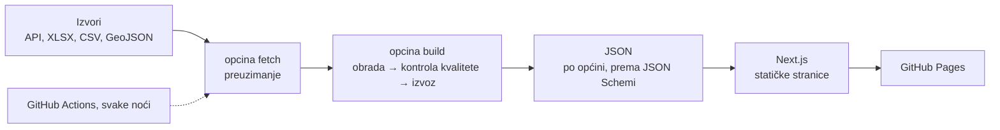

# Moja općina u brojkama: dokumentacija rješenja

Datathon Portala otvorenih podataka 2026 · Izazov **A) Društvo i javne usluge**

| | |
| --- | --- |
| Radni prototip | https://1212mauro.github.io/moja-opcina-u-brojkama/ |
| Izvorni kod | https://github.com/1212mauro/moja-opcina-u-brojkama (licenca EUPL-1.2) |
| Video prezentacija | [predstavljanje.mp4](https://github.com/1212mauro/moja-opcina-u-brojkama/releases/download/v0.4.0/predstavljanje.mp4) (2:18), [izdanje v0.4.0](https://github.com/1212mauro/moja-opcina-u-brojkama/releases/tag/v0.4.0) |
| Snimke zaslona | [docs/screenshots/](screenshots/) |

## 1. Problem

Koliko novca ima moj grad ili općina, na što ga troši, od koga kupuje i kome plaća? Odgovori su javni, ali razbacani:

- proračuni su u Excelu Ministarstva financija, jedan list po jedinici, s tisuću redaka kontnog plana;
- ugovori su u registru javne nabave;
- isplate su na portalu svakog grada posebno, u različitim oblicima;
- stanovništvo je kod DZS-a, a škole i vrtići na data.gov.hr.

Usporedba sa sličnim mjestima, jedino mjerilo koje broj čini razumljivim, ne postoji nigdje. Građanin bi morao proći desetak službenih stranica i znati čitati računski plan.

## 2. Ciljni korisnici

| Korisnik | Što dobiva |
| --- | --- |
| Stanovnici | Na jednoj stranici, jednostavnim jezikom: koliko novca ima njihovo mjesto i na što ga troši. |
| Gradski i općinski vijećnici | Brojke i usporedbu sa sličnim mjestima prije sjednice o proračunu. |
| Novinari i udruge | Nabavu, dobavljače i isplate na jednom mjestu, s poveznicom na izvor za svaki broj. |
| Gradovi i općine | Usporedbu sa sličnim jedinicama iste županije; stranicu koju mogu pokazati građanima. |

Posebno smo mislili na starije osobe, osobe s invaliditetom i one koji ne čitaju lako: postoji izdanje na jednostavnom jeziku, a stranica zadovoljava WCAG 2.1 AA.

## 3. Rješenje i funkcionalnosti

Za svaki grad i općinu jedna stranica, na hrvatskom, na jednostavnom jeziku i na engleskom:

- **Pretraga** po imenu grada ili općine ili po poštanskom broju; karta županije.
- **Ključne brojke**: prihodi i rashodi (ukupno i po stanovniku) i broj ugovora javne nabave. Uz svaku brojku piše koliko je više ili manje nego u sličnim mjestima.
- **Proračun 2019.–2025.**: odakle novac dolazi (vrste prihoda) i na što se troši (funkcijska klasifikacija: obrazovanje, promet, socijalna skrb…).
- **Usporedba** s jedinicama iste vrste i veličine u županiji (rang po stanovniku).
- **Javna nabava**: najveći dobavljači i najnoviji ugovori, od 2018.
- **Isplate iz proračuna**: kome grad plaća, po mjesecima, za zadnjih 12 mjeseci. Fizičke osobe nikad nisu imenovane.
- **Škole, vrtići i zdravstvene ustanove** u mjestu.
- **Izvori**: za svaki skup podataka izdavač, poveznica, licenca i datum zadnjeg preuzimanja. Ako izvor ne radi, stranica to kaže.
- **Kako računamo**: metodologija svake brojke na stranici.

Svaki grafikon ima rečenicu koja kaže glavno i tablicu s točnim iznosima. Sve radi i bez JavaScripta, na mobitelu, u svijetlom i tamnom načinu.

Opseg prototipa: **28 gradova i općina Varaždinske županije**, svaki s proračunom, nabavom i ustanovama. Isplate imaju pet pilot-jedinica (Lepoglava, Maruševec, Sveti Ilija, Jalžabet, Breznički Hum) i Grad Varaždin. Izbor pilota obrazložen je u [pilots.md](pilots.md).

## 4. Korišteni skupovi podataka

Rješenje koristi 16 skupova otvorenih podataka; sedamnaesti (novi EOJN API) uključit će se čim dobijemo API ključ. Detalji o svakom izvoru (oblik datoteke, način preuzimanja, poznate nepravilnosti) nalaze se u [sources.md](sources.md), a strojno čitljiv popis u `pipeline/config/sources.toml`.

| Skup podataka | Izdavač | Poveznica | Dozvola | Za što ga koristimo |
| --- | --- | --- | --- | --- |
| Financijski izvještaji JLP(R)S, PR-RAS i RAS-funkcijski (EUR) | Ministarstvo financija | [mfin.gov.hr](https://mfin.gov.hr/istaknute-teme/lokalna-samouprava/financijski-izvjestaji-jlp-r-s/203) | Javno objavljeno (licenca nije navedena) | Prihodi i rashodi 2019.–2025. |
| Registar proračunskih i izvanproračunskih korisnika | Ministarstvo financija | [rkpfi.drzavna-riznica.hr](https://rkpfi.drzavna-riznica.hr/PORTAL/Rkp) | Otvorena dozvola RH | Povezivanje OIB-a, RKP broja i šifre općine; proračunski korisnici (vrtići, knjižnice) |
| Local Administrative Units (LAU) | Eurostat | [ec.europa.eu/eurostat](https://ec.europa.eu/eurostat/web/nuts/local-administrative-units) | Ponovna uporaba uz navođenje izvora | LAU šifre jedinica |
| Popis stanovništva 2021., po gradovima/općinama | Državni zavod za statistiku | [dzs.gov.hr](https://dzs.gov.hr/u-fokusu/popis-2021/88) | Slobodno uz navođenje izvora | Stanovništvo |
| Popis stanovništva 2021., po naseljima | Državni zavod za statistiku | [dzs.gov.hr](https://dzs.gov.hr/u-fokusu/popis-2021/88) | Slobodno uz navođenje izvora | Povezivanje poštanskih brojeva s općinama (preko naselja) |
| Gradovi u statistici: procjena stanovništva | Državni zavod za statistiku | [podaci.dzs.hr](https://podaci.dzs.hr/hr/podaci/stanovnistvo/procjena-stanovnistva/) | Slobodno uz navođenje izvora | Iznosi po stanovniku za svaku godinu |
| Naselja i odredišni poštanski uredi | Hrvatska pošta d.d. | [data.gov.hr](https://data.gov.hr/ckan/dataset/naselje-i-odredisni-postanski-ured) | Licenca nije navedena | Pretraga po poštanskom broju |
| INSPIRE Administrativne jedinice | Državna geodetska uprava | [geoportal.dgu.hr](https://geoportal.dgu.hr/services/atom/au/xml) | Otvorena dozvola RH | Granice za kartu |
| Osnovne škole (e-Matica) | Ministarstvo znanosti, obrazovanja i mladih | [data.gov.hr](https://data.gov.hr/ckan/dataset/osnovne-skole) | Otvorena dozvola RH | Škole |
| Srednje škole (e-Matica) | Ministarstvo znanosti, obrazovanja i mladih | [data.gov.hr](https://data.gov.hr/ckan/dataset/srednje-skole) | Otvorena dozvola RH | Škole |
| Dječji vrtići (e-Matica) | Ministarstvo znanosti, obrazovanja i mladih | [data.gov.hr](https://data.gov.hr/ckan/dataset/djecji-vrtici) | Otvorena dozvola RH | Vrtići |
| OpenStreetMap | OpenStreetMap contributors | [openstreetmap.org](https://www.openstreetmap.org/copyright) | ODbL 1.0 | Zdravstvene ustanove; lokacije koje registri nemaju |
| Informacije o trošenju sredstava (isplate) | Gradovi i općine (Lepoglava, Maruševec, Sveti Ilija, Jalžabet, Breznički Hum, Varaždin) | portali gradova; obveza objave: [NN 59/2023](https://narodne-novine.nn.hr/clanci/sluzbeni/2023_06_59_1003.html) | Licencu ne navode | Isplate iz proračuna |
| Registri ugovora gradova i općina | Grad Ivanec, Grad Lepoglava, Grad Varaždinske Toplice | [data.gov.hr](https://data.gov.hr/) | Otvorena dozvola RH | Ugovori koje stari registar nema |
| Registar ugovora, stari EOJN RH (2018.–2023.) | Narodne novine d.d. | [eojn.nn.hr](https://eojn.nn.hr/Oglasnik/) | Javno objavljeno (licenca nije navedena) | Ugovori javne nabave |
| TED: obavijesti o dodjeli ugovora (od 2024.) | Ured za publikacije EU | [ted.europa.eu](https://ted.europa.eu/) | Ponovna uporaba uz navođenje izvora (Odluka 2011/833/EU) | Ugovori iznad EU pragova od 2024. |
| *Registar ugovora, EOJN RH (od 2024.)* | *Narodne novine d.d.* | [*eojn.hr*](https://eojn.hr/) | *Javno objavljeno* | *Spremno; čeka API ključ* |

### Povezivanje podataka

Izvori nemaju zajednički ključ, pa ga gradimo sami. Glavna tablica (`pipeline/config/municipalities.csv`) za svaku jedinicu povezuje DZS šifru, LAU šifru, OIB, RKP broj, ime u proračunskoj datoteci i granicu na karti. Preko nje:

- proračun (ključ: ime lista) povezuje se sa stanovništvom (ključ: DZS šifra), pa nastaju iznosi po stanovniku;
- ugovori (ključ: OIB naručitelja) pripisuju se gradu, zajedno s ugovorima njegovih proračunskih korisnika iz registra RKP;
- isplate se povezuju s registrima javne nabave i RKP-a preko OIB-a primatelja. Tako razlikujemo tvrtke i javna tijela od fizičkih osoba, čija se imena brišu;
- škole, vrtići i ustanove pripisuju se jedinici po adresi i koordinatama.

Iz povezanih podataka nastaje i informacija koje nema ni u jednom izvoru: usporedba sa sličnim jedinicama iste županije, iste vrste i iste veličine.

## 5. Tehnička arhitektura

- **Preuzimanje** (Python 3.12, httpx): svaki izvor ima svoj modul. Preuzimanje je pristojno: pauze između upita, ETag/Last-Modified, ponovni pokušaj. Svako preuzimanje bilježi se u dnevnik s hashom datoteke. Neuspjelo preuzimanje nikad ne briše zadnju ispravnu datoteku.
- **Obrada** (polars, openpyxl, shapely, pyproj): parseri pretvaraju izvore u pet tablica (stanovništvo, proračun, ugovori, isplate, ustanove). Iznosi u kunama preračunavaju se u eure po fiksnom tečaju 7,53450.
- **Kontrola kvalitete**: tablica se objavljuje samo ako joj se shema točno podudara, broj redaka ne odstupa više od 20 % od prošle objave i prolazi vlastite provjere. Te provjere uključuju zbroj funkcija jednak ukupnim rashodima i nijednu fizičku osobu s imenom. Inače ostaje zadnja ispravna verzija. Izvori i tablice ne ovise jedni o drugima.
- **Ugovor podataka**: Pydantic modeli → `contract/schema.json` (JSON Schema) → TypeScript tipovi za web. CI provjerava da su usklađeni.
- **Web** (Next.js 16, React 19, TypeScript): statičke HTML stranice bez poslužitelja i baze; grafikoni su SVG generiran pri izgradnji.
- **Automatizacija**: GitHub Actions svake noći preuzima izvore i objavljuje stranicu. Uz svaku izmjenu koda CI pokreće:
  - ruff i 201 test (pytest);
  - ESLint i izgradnju stranice;
  - axe-core provjeru pristupačnosti svake stranice u svijetlom i tamnom načinu;
  - provjeru izgleda na 360, 768 i 1280 px.

Detaljnije: [pipeline.md](pipeline.md) (obrada, pravila, osobni podaci), [design.md](design.md) (sučelje).

### Standardi i integracijski potencijal

- **Otvoreni formati**: JSON s objavljenom JSON Schemom, GeoJSON (WGS 84), ISO 8601 datumi, ISO 4217 valute.
- **Službeni identifikatori**: OIB, RKP broj, DZS i Eurostat LAU šifre, CPV, COFOG. Podaci se tako mogu spojiti s drugim javnim sustavima bez dodatnog mapiranja.
- **Javni JSON**: podaci svake stranice javno su dostupni na `/data/m/<ime>.json`, uz `search-index.json`, `sources.json` i `boundaries.geojson`. Mogu ih koristiti novinari, druge aplikacije ili sam Portal otvorenih podataka.
- **Izvori se čitaju preko službenih API-ja** gdje postoje: CKAN API data.gov.hr, DGU ATOM, TED API i EOJN Open Data API.
- **Bez poslužitelja**: izlaz je skup statičkih datoteka koji se može smjestiti na bilo koji web poslužitelj ili CDN, uključujući državnu infrastrukturu.

### Preduvjeti

| | |
| --- | --- |
| Tehnički | Python 3.12 i Node.js 22, bilo koje računalo ili CI servis za noćno pokretanje; bilo koji statički hosting. API ključ za EOJN RH (zatražen) za sve ugovore od 2024. |
| Organizacijski | Jedna osoba koja prati noćna izvješća i ažurira parser kad izdavač promijeni oblik datoteke. Kontakt s izdavačima (MFIN, NN, gradovi) za promjene formata. |
| Pravni | Poštovanje dozvola izvora i navođenje izvora (radi se na svakoj stranici). Dio izdavača ne navodi licencu, pa ih treba pitati. Za GDPR se imena fizičkih osoba brišu automatski, a provjera to blokira. Za pristupačnost (Zakon o pristupačnosti mrežnih stranica) potrebna je izjava o pristupačnosti s kontaktom, koja je pripremljena. |

## 6. Korisnička vrijednost

- Odgovor za koji bi trebalo desetak službenih stranica i poznavanje računskog plana dobiva se u minuti, na jednoj stranici.
- Usporedba sa sličnim mjestima daje brojkama mjerilo: „21 % manje po stanovniku od sličnih gradova” govori više od „5,6 milijuna eura”.
- Svaki broj vodi do izvora i datuma preuzimanja, pa mu se može vjerovati i provjeriti ga. 50 brojki ručno je provjereno u izvornim datotekama i sve se slažu ([spot-check.md](spot-check.md)).
- Podaci se osvježavaju sami, svake noći, bez ručnog rada.
- Pristupačno svima: jednostavan jezik, engleski, čitači zaslona, mobitel.

## 7. Daljnji razvoj

1. **Svih 556 gradova i općina.** Program već radi po županijama: potrebna je glavna tablica za ostale županije i provjera proračunskih datoteka.
2. **Svi ugovori od 2024.** preko službenog API-ja EOJN RH, čim stigne ključ. Danas od 2024. imamo samo ugovore iznad EU pragova i registre pojedinih gradova.
3. **Isplate za više mjesta**: podrška za više portala na kojima gradovi objavljuju isplate.
4. **Testiranje sa stanovnicima** (zadatak: „nađite koliko vaša općina troši na vrtiće” za manje od 60 sekundi) i s korisnicima čitača zaslona. Scenarij je spreman u [screen-reader-test.md](screen-reader-test.md).
5. **Objava naših JSON podataka na Portalu otvorenih podataka**, kao povezanog skupa podataka za ponovnu uporabu.
6. Plan za produkcijsku verziju (6 mjeseci) nalazi se u [SPEC.md](../SPEC.md) i [TASKS.md](../TASKS.md).

## 8. Ograničenja

- Prototip pokriva jednu županiju. Isplate su dostupne za 6 od 28 jedinica: ostale ih objavljuju iza CAPTCHA-e, na platformi koja odbija automatsko preuzimanje ili ne objavljuju u strojno čitljivom obliku.
- Proračunski korisnici (vrtići, knjižnice) nisu konsolidirani u proračun grada jer ih izvor ne konsolidira.
- Za dio izvora licenca nije navedena; podatke koristimo jer su javno objavljeni po zakonu, uz navođenje izvora.
- Pristupačnost je provjerena automatski (axe-core) i ručno pregledom, ali još nije testirana s korisnicima čitača zaslona.

## 9. Alati i biblioteke

Sav korišteni softver je otvorenog koda, osim alata za pomoć pri programiranju navedenog na kraju.

| Namjena | Alati |
| --- | --- |
| Obrada podataka | Python 3.12, polars, fastexcel, openpyxl, httpx, pydantic, shapely, pyproj |
| Web | Next.js 16, React 19, TypeScript |
| Kvaliteta i testovi | pytest, ruff, ESLint, Playwright, axe-core |
| Automatizacija i hosting | GitHub Actions, GitHub Pages |
| Video | Playwright (snimanje sa stranice), FFmpeg |
| Umjetna inteligencija | **Claude Code (Anthropic)**, asistent za programiranje: korišten pri pisanju koda, testova i dokumentacije. Rješenje ne koristi umjetnu inteligenciju za obradu podataka ili prikaz; svaka brojka dolazi deterministički iz izvora. |

## 10. Licenca

Kod: [EUPL-1.2](../LICENSE). Podaci: prema dozvolama izvora iz poglavlja 4; svaka stranica navodi svoje izvore.
